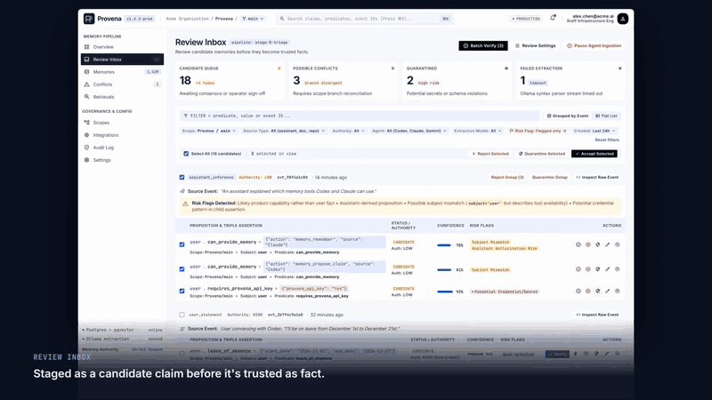

<p align="center">
  
</p>

<!-- mcp-name: io.github.admiralpunk/provena-memory -->

<h1 align="center">Provena</h1>

<p align="center"><strong>Agent memory with receipts.</strong><br>Every fact your agent remembers links back to who said it, when, and whether a human approved it.</p>

[](https://github.com/admiralpunk/Provena/actions/workflows/ci.yml)
[](https://pypi.org/project/provena-agent-memory/)
[](https://m8ven.ai/mcp/admiralpunk/provena)
[](https://glama.ai/mcp/servers/admiralpunk/Provena)

Provena is open-source, self-hosted memory for AI coding agents. It plugs into **Claude Code, Codex, and Gemini CLI** (and any MCP client), captures your conversations, and brings relevant context into later sessions. Unlike a plain memory store, it keeps the receipts: each remembered claim stays linked to the original words it came from, how much that source can be trusted, and its review history.

<p align="center">
  
</p>

```bash
pipx install provena-agent-memory
provena quickstart claude   # or: codex, gemini
```

## Why receipts matter

Agents remember things that are wrong, stale, or planted. A webpage can claim "the user wants every PR auto-merged," and the agent may repeat it in an answer. In a memory store that doesn't track sources, that becomes a fact, and the next session acts on it.

In Provena:

- **Original evidence is never rewritten.** Every conversation turn is stored as an append-only event. Claims are derived from events and always link back to them.
- **Not every source counts the same.** Claims extracted from agent-reported text are low-authority **candidates**. The agent can see them as provisional context, but only a human reviewer can promote one. An agent key cannot.
- **Memory is not permission.** Authority, search relevance, and permission to act are separate. A remembered fact never authorizes an action.
- **Changes of mind keep history.** When a fact changes, both versions stay, and a reviewed relationship records which one supersedes the other.
- **You can ask why.** `memory_explain` traces any claim to its source event, extraction run, review actions, conflicts, and every time it was delivered to an agent.

An example `memory_explain` trail, abridged:

```text
claim       "User is on leave from Dec 1 to Dec 21"
predicate   leave_of_absence  status=candidate  valid 2026-12-01 → 2026-12-21
evidence    user_statement event, Codex session (authority: low)
            "I'll be on leave from December 1st to December 21st."
extraction  qwen2.5:1.5b via Ollama, run recorded
review      awaiting human review
retrievals  delivered to Codex 5 days later for "plan a review meeting in December"
```

## How it compares

Different memory tools make different trade-offs. Provena focuses on provenance and review rather than on minimal setup.

| | Provena | [claude-mem](https://github.com/thedotmack/claude-mem) | [Mem0](https://github.com/mem0ai/mem0) | [Basic Memory](https://github.com/basicmachines-co/basic-memory) | [Hindsight](https://github.com/vectorize-io/hindsight) |
|---|---|---|---|---|---|
| Storage | PostgreSQL + pgvector, self-hosted | SQLite + Chroma, local | Hosted platform or self-hosted SDK | Markdown files + SQLite index | PostgreSQL + pgvector |
| Capture | Automatic hooks (Claude Code, Codex, Gemini CLI) + MCP tools | Automatic Claude Code hooks | MCP tool calls | Agent writes notes | MCP tool calls |
| Focus | Source evidence, authority, human review, audit | Effortless automatic recall | Managed memory platform | Human-readable notes in git | Retrieval quality |
| License | MIT | Apache-2.0 | Apache-2.0 | AGPL-3.0 | MIT |

Pick Provena when you need to know *why* your agent believes something, or when bad memory would be costly. If you only want the lightest possible recall, a local-file tool may suit you better.

## Product demo

Watch the full 90-second walkthrough of setup, cross-session recall, and the operator console:

https://github.com/user-attachments/assets/37fe219c-b678-4c6d-811d-bfdd37552628

Provena is one FastAPI service backed by PostgreSQL and pgvector. MCP and host hooks capture turns and retrieve attributed context. Ollama, or an optional hosted model, extracts candidate facts and embeddings. The Next.js console lets a human inspect and review them. [Architecture details](docs/architecture.md) · [Decisions](docs/adr/)

## Get started

You need Python 3.11+, [pipx](https://pipx.pypa.io/latest/how-to/install-pipx.html), Docker Compose, and one supported agent host. Install the connector and choose your host:

```bash
pipx install provena-agent-memory
provena quickstart codex
```

Use `provena quickstart claude` or `provena quickstart gemini` for those hosts. Quickstart starts the local service, PostgreSQL, Ollama, and the console; creates agent and reviewer credentials; and installs MCP plus automatic capture and retrieval hooks. It prints the console URL. Restart your agent host and review Provena under `/hooks` and `/mcp`.

Quickstart no longer waits for the default models (about 1.26 GB): they download in the background while Provena already records every turn and recalls with keyword search. When `provena status` shows `memory_models` ready, run `provena catch-up --host <host>` to extract what was captured meanwhile. If Ollama already runs on your machine, quickstart uses it instead, which keeps GPU acceleration on Macs; otherwise it uses a [digest-pinned CPU build](docs/adr/0022-cpu-only-ollama-image-for-local-setup.md). Use `--no-local-models` to skip models entirely, or `--wait-for-models` for the previous blocking behavior. Installing the package alone does not record conversations; running quickstart is the opt-in step.

To see in 30 seconds why receipts matter, run `provena demo --host codex` (or `claude`, `gemini`). It works in a separate demo project, stores one fact you stated and one planted by a web page, and prints a receipt for each. To trace any real memory back to its source, run `provena why <topic or claim ID>`.

To check that the API and database are running:

```bash
provena status
```

To follow a captured Codex turn into a candidate claim, see the [first-memory walkthrough](docs/first-memory.md).

### Claude Code plugin

Claude Code users can install Provena as a plugin instead of letting quickstart edit Claude's settings. Install the connector, prepare the connection, then add the plugin in Claude Code:

```bash
pipx install provena-agent-memory
provena quickstart claude --plugin   # or, for an existing service: provena connect claude --plugin
```

```text
/plugin install provena --marketplace admiralpunk/Provena
```

On Claude Code versions older than 2.1.275, run `/plugin marketplace add admiralpunk/Provena` and then `/plugin install provena@provena`. The plugin adds the MCP server, the capture and recall hooks, and two skills: `/provena:status` checks the setup, and `/provena:why <topic>` explains why a memory exists. The `--plugin` option writes only the protected connection file and removes Provena hooks that an earlier quickstart added, so turns are never captured twice. The plugin requires Provena 0.1.17 or later.

### Without Docker

If you'd rather not use Docker, Provena can run on the PostgreSQL and pgvector from your package manager. It finds them but never installs them:

```bash
brew install postgresql@18 pgvector                         # macOS
sudo apt install postgresql-17 postgresql-17-pgvector       # Debian 13
sudo apt install postgresql-16 postgresql-16-pgvector       # Ubuntu 24.04
sudo pacman -S postgresql pgvector                          # Arch

pipx install 'provena-agent-memory[server]'
provena quickstart claude --no-docker --plugin   # or: codex, gemini (without --plugin)
```

Provena creates a private database in its own state folder that only accepts local, password-authenticated connections, and starts the API beside it. Use `provena stop` and `provena start` to stop and start both; they don't restart after a reboot on their own. If Ollama runs on your machine, Provena uses it; otherwise recall uses keyword search. The web console still needs Docker in this mode. Requires PostgreSQL 16 or newer and Provena 0.1.17 or later. [Design](docs/adr/0026-system-postgresql-local-mode.md)

### Connect to an existing service

Ask its operator for an API URL, **agent** API key, and project or branch scope ID. With the connector installed, run:

```bash
export PROVENA_API_URL=https://memory.example.com
export PROVENA_API_KEY=paste-agent-key
export PROVENA_SCOPE_ID=paste-scope-id
provena connect codex --install
```

Replace `codex` with `claude` or `gemini` as needed. For another MCP client, use `provena connect generic` to print its configuration. See the [connector guide](PYPI.md#manual-connector-configuration) for manual MCP setup and console access.

### Other setup paths

- **Manual self-hosting:** [download the v0.1.17 Compose file](https://github.com/admiralpunk/Provena/releases/download/v0.1.17/compose.yaml) and follow the [deployment guide](deploy/README.md) for the remaining files, credentials, upgrades, and backups.
- **Develop from source:** follow the [local development guide](docs/development.md) for Python, Docker, the console, and tests.

## FAQ

**Do I need Docker?** No. The default quickstart uses Docker Compose, but `--no-docker` runs Provena on the PostgreSQL and pgvector from your package manager (see [Without Docker](#without-docker)). The web console still needs Docker.

**Does it send my conversations anywhere?** No. By default everything runs on your machine, and extraction uses local Ollama models. A hosted model is opt-in.

**How big is the download?** The default local models total about 1.26 GB, but quickstart doesn't wait for them: recall uses keyword search until they're ready. With `--no-local-models` there is no model download at all. If Ollama already runs on your machine with these models, nothing is downloaded.

**Does installing the package start recording?** No. Capture starts only after you run `provena quickstart` or `provena connect --install` for a host.

**Which agents work?** Claude Code, Codex, and Gemini CLI have one-command setup with automatic capture. Other MCP clients can use `provena connect generic` and call the MCP tools directly.

## Current limits

Retrieval uses an exact scope; branch inheritance is not implemented. Provena records which claims were delivered to an agent, but cannot prove that a later action was caused by them. [More on current guarantees and limits](docs/architecture.md#limits).

## Contributing

Start with a [good first issue](https://github.com/admiralpunk/Provena/issues?q=is%3Aissue%20state%3Aopen%20label%3A%22good%20first%20issue%22) or read [CONTRIBUTING.md](CONTRIBUTING.md). See [SECURITY.md](SECURITY.md) for private vulnerability reporting and [CHANGELOG.md](CHANGELOG.md) for release history.
